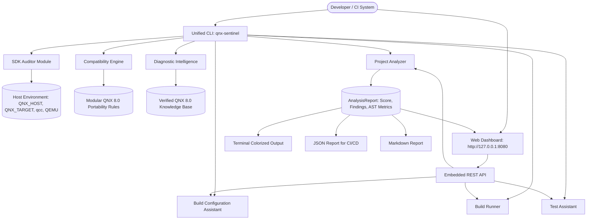

# QNX Sentinel — Architectural Specification

## 1. Architectural Philosophy

**QNX Sentinel** is built from the ground up to solve the real-world friction of cross-compiling, validating, and testing software for **QNX SDP 8.0** on modern developer workstations (Windows, Linux, macOS).

Core design principles:
1. **Host-Tool Independence:** Developers can analyze codebases, generate verified QNX CMake toolchains, and simulate build/test cycles without requiring dedicated hardware or immediate access to an active QNX license on that workstation.
2. **Deterministic Attribution:** Actual execution results (via physical hardware or QEMU) are strictly distinguished from simulated execution passes.
3. **Safe Automation:** Files are never modified or overwritten without explicit user confirmation (`--apply`).
4. **Zero-Dependency Core:** Implemented using Python 3.8+ standard libraries, ensuring instant portability across developer environments.

---

## 2. High-Level Component Architecture

---

## 3. Subsystem Breakdown

### A. SDK & Environment Auditor (`qnx_sentinel.audit`)
- **Purpose:** Inspects host workstation environment variables and tool paths.
- **Checked Inputs:**
  - `QNX_HOST`: Path to host binaries (`qcc`, `q++`, `mkqnximage`).
  - `QNX_TARGET`: Path to target sysroots (`aarch64le`, `x86_64`) and headers (`/usr/include`).
  - `QNX_CONFIGURATION`: Path to license and system configuration files.
  - Emulator: Probes PATH for `qemu-system-aarch64` and `qemu-system-x86_64`.
  - Image Runner: Checks for QNX 8.0 Quick Start Target Image utility (`mkqnximage`).
- **Graceful Fallback:** If the SDP is absent, reports precise setup instructions (`call C:\qnx800\qnxsdp-env.bat` or `source ~/qnx800/qnxsdp-env.sh`) and seamlessly transitions Sentinel into host-static and simulated verification mode.

### B. Project Structure & Dependency Analyzer (`qnx_sentinel.analyzer.project_analyzer`)
- **Purpose:** Discovers project taxonomy, code volume, and build orchestration.
- **Analysis Scope:**
  - Traverses directory trees while honoring exclusion rules (`.git`, `build`, etc.).
  - Classifies C (`.c`), C++ (`.cpp`, `.cc`, `.cxx`), headers (`.h`, `.hpp`), and build files.
  - Detects build systems: CMake, QNX Recursive Make (`common.mk`), and GNU Make.
  - Detects missing QNX 8.0 build files (`qnx.toolchain.cmake`, `CMakePresets.json`).
  - Scans build files for non-portable host libraries: `-lpthread`, `-ldl`, `-lrt`, `-march=native`, `-m64`.

### C. QNX Compatibility Engine (`qnx_sentinel.analyzer.compatibility_engine`)
- **Purpose:** Applies modular static analysis rules to identify non-portable code.
- **Extensible Architecture:** All rules derive from `BaseRule` with standard metadata:
  - `rule_id`: Standardized identifier (e.g. `QNX-001-EPOLL`).
  - `category`: `FindingCategory` enum.
  - `severity`: `Severity` enum (`CRITICAL`, `WARNING`, `BEST_PRACTICE`, `INFO`).
  - `remediation`: Human-readable migration instructions.
  - `remediation_code`: Verified QNX 8.0 drop-in code example.
  - `documentation_url`: Official QNX SDP 8.0 documentation anchor.
- **Rule Categories:**
  - `linux_syscalls.py`: epoll, timerfd, eventfd, signalfd, inotify.
  - `gnu_extensions.py`: pthread_yield, get_current_dir_name, strndupa, cpu_set_t.
  - `filesystem_proc.py`: `/proc/self/exe`, `/sys/class`, `/dev/shm`.
  - `process_threads.py`: `prctl()`, multi-threaded `fork()`, real-time priorities (1-255).
  - `ipc_primitives.py`: System V IPC vs POSIX shared memory vs Neutrino messaging.
  - `compiler_flags.py`: Deprecated `-lang-c++`, hardcoded GCC flags.
  - `qnx_idioms.py`: System logging (`slog2`), proper channel resource management.

### D. Build Configuration Assistant (`qnx_sentinel.builder.config_assistant`)
- **Purpose:** Guides developers transitioning build systems to QNX SDP 8.0.
- **Generated Artifacts:**
  - `qnx.toolchain.cmake`: Official CMake cross-compilation toolchain file pointing to `qcc` and `q++`, targeting `aarch64le` or `x86_64` sysroots, and defaulting to LLVM `libc++`.
  - `CMakePresets.json`: Reusable configure and build presets for Debug and Release builds on ARM and x86.
  - `common.mk`: Template for QNX recursive make system integration.
- **Safety Mechanism:** Generates unified diffs (`difflib`) for visual preview. Requires explicit confirmation (`--apply` or UI confirmation) before modifying or creating any files.

### E. Cross-Compilation & Verification Runner (`qnx_sentinel.builder.build_runner`)
- **Dual Execution Modes:**
  1. **Actual Toolchain Mode:** When `QNX_HOST` and `qcc` are present, invokes `cmake` and `qcc` with the QNX toolchain file.
  2. **SDK Simulated Verification Mode:** When running on a host without QNX SDP 8.0, performs AST/syntax verification and faithfully reproduces the exact compiler and linker diagnostics that QNX 8.0 `qcc` (GCC 12.2 / Clang) would emit.
- **Unambiguous Attribution:** Every build result is explicitly tagged with `execution_mode: "ACTUAL_QNX_SDP_8_0"` or `execution_mode: "SDK_SIMULATED_VERIFICATION"`.

### F. Target Test Assistant (`qnx_sentinel.tester.test_runner`)
- **Target Discovery:** Probes for configured hardware targets (via `QNX_TARGET_IP` and SSH), QEMU virtual targets (via port 2222 or `mkqnximage`), and host simulated test harnesses.
- **Test Execution:** Dispatches test suites and parses results, emitting an explicit simulation banner when running in simulated mode.

### G. Diagnostic Intelligence Engine (`qnx_sentinel.diagnostics.error_explainer`)
- **Input:** Raw compiler output, linker errors, or build logs.
- **Knowledge Base (`kb.py`):** Verified regex patterns mapped to root-cause explanations and suggested code diffs.
- **Documentation Linkage:** Direct URLs to official QNX SDP 8.0 online reference topics.

### H. Developer Dashboard & Reporters (`qnx_sentinel.reporter`)
- **Terminal Reporter:** Rich colorized output with ASCII severity badges, score meters, and highlighted code snippets.
- **JSON Reporter:** Standardized machine-readable format for integration into CI/CD pipelines.
- **Markdown Reporter:** GitHub Flavored Markdown summary suitable for pull requests and audits.
- **Web Dashboard:** Embedded, zero-dependency HTTP server (`http://127.0.0.1:8080`) providing a reactive UI with search, filtering, diff viewers, and one-click build/test controls.

---

## 4. QNX 8.0 Readiness Scoring Algorithm

The **QNX 8.0 Readiness Index** ($S \in [0, 100]$) evaluates codebase portability:

$$S = \max\left(0, 100 - \sum \text{Deductions}\right)$$

Deduction weights:
- **`CRITICAL`:** $-15$ points each (Fatal compile/link failure or missing syscall on QNX).
- **`WARNING`:** $-5$ points each (Non-standard POSIX assumption, GNU glibc extension).
- **`BEST_PRACTICE`:** $-2$ points each (Sub-optimal logging or microkernel design pattern).
- **`INFO`:** $-1$ point each (Redundant library link).
- **Missing Build Configurations:** $-5$ to $-20$ points (Missing toolchain or presets).

Letter Grade scale:
- **`A`**: $S \ge 90$ (Production-ready for QNX 8.0)
- **`B`**: $80 \le S < 90$ (Minor non-blocking adjustments)
- **`C`**: $70 \le S < 80$ (Portability remediation required)
- **`D`**: $60 \le S < 70$ (Substantial Linux-specific dependencies)
- **`F`**: $S < 60$ (Incompatible Linux kernel dependencies)
